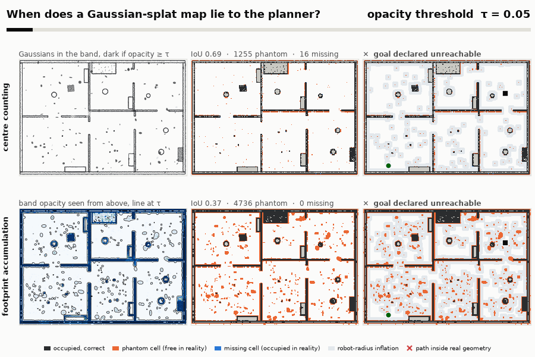
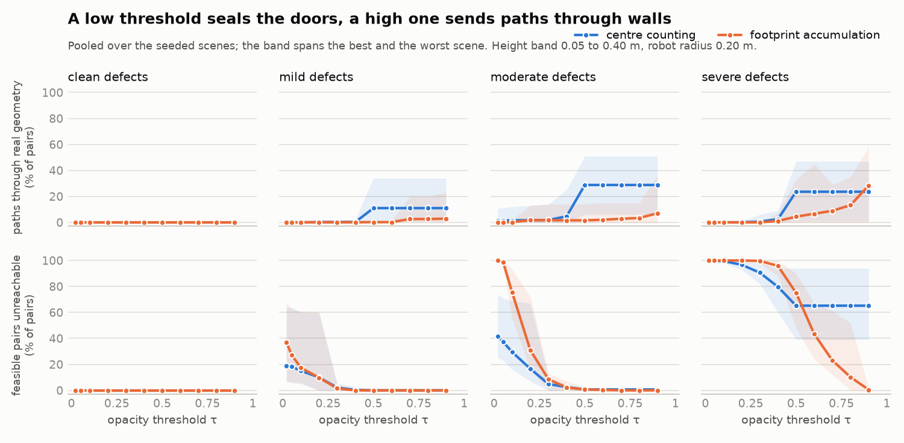
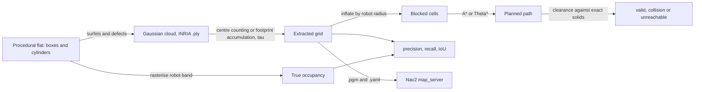

# splat-navmap

**Measures when an occupancy grid sliced from a 3D Gaussian Splatting scene makes a planner drive through walls or refuse to use a doorway, on synthetic flats whose true geometry is known.**

[](https://github.com/guilhem0908/splat-navmap/actions/workflows/ci.yml)

[Results](#results) - [Quickstart](#quickstart) - [How it works](#how-it-works) - [Limitations](#limitations)



The Gaussians in this project are synthetic (surfels on analytic geometry plus modelled defects), not trained splats. Read [Limitations](#limitations) before drawing conclusions about real scenes.

## Why this exists

This is a personal side project, written in October 2026 with AI assistance (Claude), that extends a question from my internship at AIST in Tsukuba (April to August 2026). In my report I derived an occupancy grid from a horizontal slice of a supplied 3D Gaussian Splatting scene, filtered small isolated components, added a safety margin and planned on it with A*; I also noted that the relation between Gaussian opacity and collision geometry stayed only partially validated. Here I study that relation where it can be measured: on generated flats with exact geometry, every map is scored cell by cell and every planned path is checked against the true solids. Nothing from the internship is reused (no scene, no data, no code), and the grid in my public repository [nav_3dgs_pano](https://github.com/guilhem0908/nav_3dgs_pano) is built from simulator collision boxes, not from Gaussians.

## Results

**With moderate defects, centre counting has no good threshold (τ = 0.3 leaves 4.9 % of feasible pairs unreachable, τ = 0.5 sends 28.8 % of paths through real geometry), while footprint accumulation at τ = 0.5 leaves 0.7 % unreachable and 1.6 % colliding; both need a height band that starts above the floor.**

Setup: 10 scenes (seeds 0 to 9) with 100 start-goal pairs each, so 1,000 start-goal pairs per setting; every pair is feasible in the true geometry. Robot: disc of radius 0.20 m, body from 0.02 to 0.40 m, 5 cm grid, A*, band 0.05 to 0.40 m. A path *collides* when the robot disc along it comes closer than its radius to a true solid; a pair is *unreachable* when the planner finds no path or an endpoint is blocked. Counts sit next to percentages (pooled over scenes). `scripts/reproduce.py` regenerates the results and figures; `scripts/check_readme.py` checks every number below against them.

<!-- table:sweep -->
| method | τ | precision | recall | IoU | paths through real geometry | feasible pairs unreachable | length / optimum |
| :--- | :--- | ---: | ---: | ---: | ---: | ---: | ---: |
| centre counting | 0.1 | 0.737 | 0.980 | 0.726 | 16 (1.6 %) | 295 (29.5 %) | 1.038 |
| centre counting | 0.3 | 0.751 | 0.963 | 0.730 | 18 (1.8 %) | 49 (4.9 %) | 1.008 |
| centre counting | 0.5 | 0.747 | 0.855 | 0.662 | 288 (28.8 %) | 7 (0.7 %) | 1.002 |
| centre counting | 0.7 | 0.747 | 0.855 | 0.663 | 288 (28.8 %) | 7 (0.7 %) | 1.002 |
| centre counting | 0.9 | 0.747 | 0.855 | 0.663 | 288 (28.8 %) | 7 (0.7 %) | 1.002 |
| footprint accumulation | 0.1 | 0.488 | 0.995 | 0.487 | 2 (0.2 %) | 753 (75.3 %) | 1.226 |
| footprint accumulation | 0.3 | 0.618 | 0.994 | 0.615 | 17 (1.7 %) | 85 (8.5 %) | 1.014 |
| footprint accumulation | 0.5 | 0.657 | 0.990 | 0.652 | 16 (1.6 %) | 7 (0.7 %) | 1.008 |
| footprint accumulation | 0.7 | 0.684 | 0.979 | 0.674 | 28 (2.8 %) | 0 (0.0 %) | 1.007 |
| footprint accumulation | 0.9 | 0.713 | 0.900 | 0.661 | 70 (7.0 %) | 0 (0.0 %) | 1.004 |
<!-- /table:sweep -->



- **Centre counting** is flat from τ = 0.5 to 0.9: every real surface Gaussian has opacity 0.90 to 0.99, so only the weak patches (0.05 to 0.45) change, and they are already gone at 0.5. Below that, floaters (up to 0.62) block doors.
- **Footprint accumulation** renders the band from above, so a floater counts only for the share of its density inside the band, and the Gaussians of a surface add up. Its grid is fatter (IoU 0.652 at τ = 0.5 against 0.730 for centres at τ = 0.3), yet it plans better: a better IoU did not predict a better plan.
- **The spread between scenes is large.** At τ = 0.5 footprint accumulation collides on 1.6 % of pairs overall and on up to 14.0 % in the worst scene.

Defect level and single defects (each at its severe magnitude), at each method's operating point (centres τ = 0.3, footprint τ = 0.5). Clean flats never fail, mild defects are harmless and severe ones defeat both (90.6 % and 75.0 % of pairs unreachable). Floaters alone seal doors for centre counting (14.0 % unreachable) and hardly for footprint accumulation (0.1 %); fuzzy surfaces are the worst single defect for both (91.1 % and 93.7 % unreachable), which I attribute to isolated cells scattered over the floor.

<!-- table:defects -->
| defects | centres, τ = 0.3: collide | centres, τ = 0.3: unreachable | footprint, τ = 0.5: collide | footprint, τ = 0.5: unreachable |
| :--- | ---: | ---: | ---: | ---: |
| clean | 0.0 % | 0.0 % | 0.0 % | 0.0 % |
| mild | 0.2 % | 2.1 % | 0.2 % | 0.0 % |
| moderate | 1.8 % | 4.9 % | 1.6 % | 0.7 % |
| severe | 0.6 % | 90.6 % | 4.4 % | 75.0 % |
| floaters only | 0.0 % | 14.0 % | 0.0 % | 0.1 % |
| holes only | 4.2 % | 0.0 % | 1.7 % | 0.0 % |
| weak patches only | 0.1 % | 0.0 % | 0.2 % | 0.0 % |
| fuzzy surfaces only | 0.0 % | 91.1 % | 0.0 % | 93.7 % |
<!-- /table:defects -->

Height band, moderate defects. A band that touches the floor lets the floor leak into the map (100.0 % unreachable); a thin slice at mid height misses the low crates and the wall cabinet (40.8 % and 55.6 % collide); a band up to 0.90 m picks up table tops and foliage the robot can pass under (24.6 % and 8.9 % unreachable).

<!-- table:bands -->
| height band (m) | centres: collide | centres: unreachable | footprint: collide | footprint: unreachable |
| :--- | ---: | ---: | ---: | ---: |
| 0.02 to 0.40 | 0.0 % | 100.0 % | 0.0 % | 100.0 % |
| 0.00 to 0.40 | 0.0 % | 100.0 % | 0.0 % | 100.0 % |
| 0.05 to 0.40 | 1.8 % | 4.9 % | 1.6 % | 0.7 % |
| 0.10 to 0.40 | 3.7 % | 3.6 % | 2.5 % | 0.0 % |
| 0.05 to 0.20 | 3.0 % | 3.0 % | 3.3 % | 0.7 % |
| 0.05 to 0.90 | 1.8 % | 24.6 % | 1.5 % | 8.9 % |
| 0.18 to 0.22 | 40.8 % | 0.8 % | 55.6 % | 0.0 % |
<!-- /table:bands -->

Planner and filter, moderate defects. Theta* changes the collision rate little. Dropping occupied groups under 4 cells removes the isolated cells that seal doors (4.9 % to 0.0 % unreachable for centre counting) at almost no cost in collisions; under 10 cells it erases thin wall fragments and collisions jump to 25.2 % and 21.5 %.

<!-- table:variants -->
| variant | centres: collide | centres: unreachable | footprint: collide | footprint: unreachable |
| :--- | ---: | ---: | ---: | ---: |
| A*, no filter | 1.8 % | 4.9 % | 1.6 % | 0.7 % |
| Theta*, no filter | 1.3 % | 4.9 % | 1.1 % | 0.7 % |
| A*, drop groups under 4 cells | 2.0 % | 0.0 % | 1.6 % | 0.0 % |
| A*, drop groups under 10 cells | 25.2 % | 0.0 % | 21.5 % | 0.0 % |
<!-- /table:variants -->

CPU timings (median of three runs, Windows laptop, Python 3.14, grid of 41,650 cells, one flat of 203,848 Gaussians): footprint extraction 0.8 s, centre counting 8 ms, A* 14 ms and Theta* 24 ms per path; the whole benchmark took 27 min on 4 processes while the machine was shared.

## How it works



The scene generator splits a flat into rooms with doors and furnishes it with pieces chosen to exercise the height band (a table whose top is above the robot, low crates, a floating cabinet, a rug below the ground clearance). Its reconstruction covers each visible face with flat Gaussians and adds four defects with explicit knobs: floaters, holes, weak (low-opacity) patches and thickness.

Footprint accumulation follows the 3DGS image-formation model, looking down. Along the vertical ray through a cell, a Gaussian with opacity α, 2D marginal covariance Σ and conditional height distribution N(m, s²) contributes, and a cell takes its most opaque ray:

```
a(x, y) = α · exp(-½ dᵀ Σ⁻¹ d) · [Φ((z_hi − m) / s) − Φ((z_lo − m) / s)],   score = 1 − Π (1 − aᵢ)
```

The band factor is exact (Schur complement of the 3D covariance) and is tested against numerical integration along the rays. Inflation is conservative: a cell is blocked if any point of it is closer than the radius to any point of an occupied cell, so planning on the exact grid never collides and every collision measured on an extracted grid comes from the map. `docs/design.md` holds the derivations and the evaluation protocol.

## Quickstart

Linux or macOS (Python 3.11 or newer):

```bash
git clone https://github.com/guilhem0908/splat-navmap && cd splat-navmap
python -m venv .venv && source .venv/bin/activate
pip install -e ".[dev]"
pytest -m "not slow"                    # under a minute
python scripts/check_readme.py          # README numbers against results/
python scripts/reproduce.py --quick     # 2 scenes, 1 to 3 minutes; the full run takes about 30 minutes on 4 processes
splat-navmap generate --seed 3 --defects mild --out out/flat.ply --truth out/truth
splat-navmap extract out/flat.ply --method footprint --tau 0.5 --min-component 4 --out out/flat
splat-navmap plan out/flat.yaml --start 1 1 --goal 8 6 --planner theta --preview out/plan.png
```

Windows PowerShell, then run the remaining commands above unchanged:

```powershell
git clone https://github.com/guilhem0908/splat-navmap; cd splat-navmap
python -m venv .venv; .venv\Scripts\Activate.ps1; pip install -e ".[dev]"
```

`extract` reads any binary INRIA-layout `.ply` (z up, metres) and writes a `.pgm` and `.yaml` pair that Nav2's `map_server` reads; Nav2 inflates obstacles itself, so the raw grid is exported.

## Repository layout

```
src/splat_navmap/   scene, geometry (exact flats), synth (Gaussians and defects), gaussians, ply_io,
                    extract (the two extractors), grid, planners (A*, Theta*), evaluate, benchmark,
                    nav2 (map_server files), cli, viz
scripts/            reproduce.py (seeded benchmark and figures), check_readme.py (README against results/)
results/            per-scene counts, summary, config, timings
docs/               hero.gif, tradeoff.png, design.md (derivations and protocol)
tests/              one file per module
```

## Limitations

- **Synthetic Gaussians.** The reconstruction is surfels on analytic geometry plus four defects whose magnitudes I chose (floater opacity up to 0.62, weak patches 0.05 to 0.45). The flat plateau of centre counting above τ = 0.5 follows directly from those choices; real scenes will have other failure modes. No trained scene was tested.
- **Small world.** 10 flats of 9 to 12 m by 7 to 9 m, one robot (a disc of 0.20 m), one grid resolution, a static 2D map, no localisation error. The reader follows the INRIA layout and is tested on files written by this repository.
- **Collision means geometry only.** A path collides when the robot disc meets a true solid at body height; dynamics and sensing are not modelled.
- **Length ratios** are averaged over valid paths only, so they are not comparable between settings with very different validity.
- **Nav2 export is not run against Nav2.** Files are tested for round trip and for the `map_server` format; there is no ROS 2 node.
- Timings come from a shared laptop and vary several-fold from run to run.

## References

- B. Kerbl, G. Kopanas, T. Leimkühler, G. Drettakis, [3D Gaussian Splatting for Real-Time Radiance Field Rendering](https://arxiv.org/abs/2308.04079), SIGGRAPH 2023.
- M. Zwicker, H. Pfister, J. van Baar, M. Gross, [EWA Volume Splatting](https://doi.org/10.1109/VISUAL.2001.964490), IEEE Visualization 2001.
- P. Hart, N. Nilsson, B. Raphael, [A Formal Basis for the Heuristic Determination of Minimum Cost Paths](https://doi.org/10.1109/TSSC.1968.300136), 1968.
- K. Daniel, A. Nash, S. Koenig, A. Felner, [Theta*: Any-Angle Path Planning on Grids](https://doi.org/10.1613/jair.2994), JAIR 2010.
- A. Rahimi, B. Recht, Random Features for Large-Scale Kernel Machines, NeurIPS 2007 (the smooth field of the weak patches).
- [Nav2 map server](https://docs.nav2.org/configuration/packages/configuring-map-server.html), the `.pgm` and `.yaml` map format.

---

Guilhem Carmouze - robotics engineering student, UPSSITECH (University of Toulouse) - [LinkedIn](https://www.linkedin.com/in/guilhem-carmouze/) - https://guilhem0908.github.io
